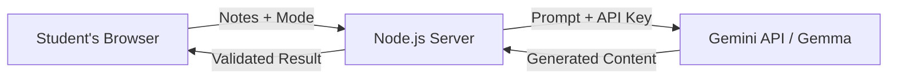

<div align="center">


# StudySaathi AI

**Your smarter study companion.** Paste your notes, get a simple explanation, a quick summary, or a practice quiz.


</div>

---

## Table of Contents

- [The Problem](#the-problem)
- [Our Solution](#our-solution)
- [Screenshots](#screenshots)
- [Features](#features)
- [How It Works](#how-it-works)
- [Quick Start](#quick-start)
- [Configuration](#configuration)
- [Security](#security)
- [Deploy](#deploy)
- [API Routes](#api-routes)
- [Project Structure](#project-structure)
- [Testing Status](#testing-status)
- [Roadmap](#roadmap)
- [Team Hackers](#team-hackers)
- [License](#license)

## The Problem

Students collect pages of notes but often have limited time to understand them, summarize them, and test themselves. Switching between a chat tool, notes app, and quiz platform wastes time and breaks focus.

## Our Solution

**StudySaathi AI** (*saathi* means companion) brings everything into one clean workspace.

Paste your notes once and choose what you need:

- 💡 **Explain** difficult concepts in simple, student-friendly language
- 📝 **Summarize** notes into key concepts and takeaways
- 🎯 **Practice** with automatically generated multiple-choice quizzes

The application uses Google's **Gemma** model through the **Gemini API** from a Node.js backend. In the server version, the API key stays on the server and is never exposed to the browser.

## Screenshots

### Home


### Quick Summary


### Practice Quiz


> The screenshots use sample content to demonstrate the application UI and workflow.

## Features

- 💡 **Explain Notes** — simple, student-friendly explanations with examples
- 📝 **Quick Summary** — summary, key concepts, and important takeaways
- 🎯 **Practice Quiz** — 5 multiple-choice questions with 4 options each
- 🔐 **Server-side API key** — the Gemini API key is kept out of the browser
- ⚙️ **Settings drawer** — connection test, key status, and model information
- 📱 **Responsive UI** — works across desktop and mobile layouts
- 🎨 **Modern dark interface** — gradient design with smooth animations
- ♿ **Reduced-motion support** — respects users who prefer reduced animations
- 🛡️ **Input validation** — validates requests before sending them to the AI
- 🚦 **Rate limiting** — protects the API from excessive requests
- 📊 **Daily usage limit** — configurable application-wide request cap
- 🧹 **Escaped AI output** — prevents scripts inside generated text from executing
- 📦 **Zero npm dependencies** — no `npm install` required

## How It Works



### Request Flow

1. The student pastes their notes into the application.
2. They select **Explain**, **Summary**, or **Quiz**.
3. The browser sends the notes and selected mode to the Node.js server.
4. The server validates the request and builds the appropriate AI prompt.
5. The server sends the request to Google's Gemini API using Gemma.
6. The response is validated and processed.
7. The browser displays the final result.

For quizzes, the server strictly parses the generated JSON and validates that there are exactly **5 questions with 4 options each**.

If the AI request fails, the application shows a clear error instead of displaying fabricated content.

## Quick Start

### Requirements

- **Node.js 18+**
- A Google AI Studio / Gemini API key

### Option A — Server Version (Recommended)

Clone the repository:

```bash
git clone https://github.com/YOUR_USERNAME/studysaathi-ai.git
cd studysaathi-ai
```

Run the application:

```bash
node studysaathi.js
```

The application will ask for your API key in the terminal. The key is kept in memory for that process.

Then open:

```text
http://localhost:3000
```

### Using a `.env` File

Create a `.env` file from the example:

```bash
cp .env.example .env
```

Then set:

```env
GEMINI_API_KEY=your_api_key_here
```

Start the server:

```bash
npm start
```

> Never commit a real API key to GitHub.

### Option B — Browser-only Version

Open `studysaathi.html` directly in Chrome or Edge.

Then:

1. Click the ⚙️ Settings button.
2. Paste your API key.
3. Click **Test Connection**.
4. Start studying.

The browser-only version keeps the key only in that browser tab's memory.

> **Important:** Do not publicly host the browser-only version with a real API key embedded in the page. For deployment, use the server version.

## Configuration

The server supports the following environment variables:

| Variable | Default | Purpose |
|---|---|---|
| `GEMINI_API_KEY` | None | Google AI Studio API key |
| `GEMMA_MODEL` | `gemma-4-26b-a4b-it` | Gemma model used by the application |
| `PORT` | `3000` | Server port |
| `DAILY_LIMIT` | `500` | Maximum AI requests per day |

Example:

```env
GEMINI_API_KEY=your_api_key_here
GEMMA_MODEL=gemma-4-26b-a4b-it
PORT=3000
DAILY_LIMIT=500
```

## Security

StudySaathi AI includes several protections:

- API keys are read from environment variables or entered temporarily in memory.
- Server-side keys are never returned to the browser.
- `.env` files are excluded through `.gitignore`.
- Notes are limited to **12,000 characters**.
- Requests are limited to **50 KB**.
- Rate limiting protects the API from excessive requests.
- A configurable daily request cap is included.
- Security headers such as Content Security Policy are enabled.
- AI-generated output is escaped before being inserted into the page.
- Failed AI requests return errors instead of fake or fallback AI content.

### If Your API Key Leaks

Immediately revoke/delete the exposed key in Google AI Studio and generate a new one.

**Never commit a real API key to GitHub.**

## Deploy

### Render

The project includes a `render.yaml` blueprint for deployment.

1. Push the repository to GitHub.
2. Open Render.
3. Select **New → Blueprint**.
4. Connect your GitHub repository.
5. Add `GEMINI_API_KEY` as an environment variable.
6. Deploy.
7. Check `/api/health`.
8. Open the application and use **Settings → Test Connection**.

> Free Render instances may sleep when idle, so the first request after inactivity can take some time.

Any hosting provider capable of running:

```bash
node studysaathi.js
```

and supporting environment variables can be used.

## API Routes

| Method | Route | Purpose |
|---|---|---|
| `GET` | `/api/health` | Checks whether the server is running |
| `GET` | `/api/status` | Returns configuration status without exposing the API key |
| `POST` | `/api/test` | Tests the Google/Gemma connection |
| `POST` | `/api/generate` | Generates an explanation, summary, or quiz |

### Generate Request

```json
{
  "mode": "explain",
  "notes": "Your study notes here..."
}
```

Supported modes:

```text
explain
summary
quiz
```

## Project Structure

```text
studysaathi-ai/
├── studysaathi.js       # Node.js server + complete web application
├── studysaathi.html     # Browser-only version
├── package.json
├── render.yaml          # Render deployment blueprint
├── .env.example         # Environment variable template
├── .gitignore
├── LICENSE
├── README.md
└── docs/
    ├── banner.png
    ├── home.png
    ├── summary.png
    └── quiz.png
```

## Testing Status

The application has been tested for:

- API route behavior
- Input validation
- Rate limiting
- Daily request limits
- Quiz JSON parsing
- Output escaping
- Settings functionality
- Copy and clear actions
- Responsive/mobile layout
- API-key exposure checks

### Not Covered

Live calls to Google's API with a real production key are not part of the automated test setup.

Use **Settings → Test Connection** to verify your own API key and selected model.

## Roadmap

- [ ] Upload PDF notes
- [ ] Upload image-based notes
- [ ] Save quiz history
- [ ] Track weak topics
- [ ] Flashcards
- [ ] Spaced-repetition learning
- [ ] Hindi and multilingual support
- [ ] Quiz difficulty levels
- [ ] Student progress dashboard

## Team Hackers

Built for a hackathon by **Team Hackers**:

| Member |
|---|
| Vishisht Viraj |
| Kundan Kumar |
| Ayush Raj |
| Krish Chand |
| Nelakurthi Vikranth |

## License

This project is licensed under the **MIT License**.

See [`LICENSE`](LICENSE) for details.

---

<div align="center">

**StudySaathi AI — Turn your notes into knowledge. 📚✨**

Built with ❤️ by **Team Hackers**

</div>
